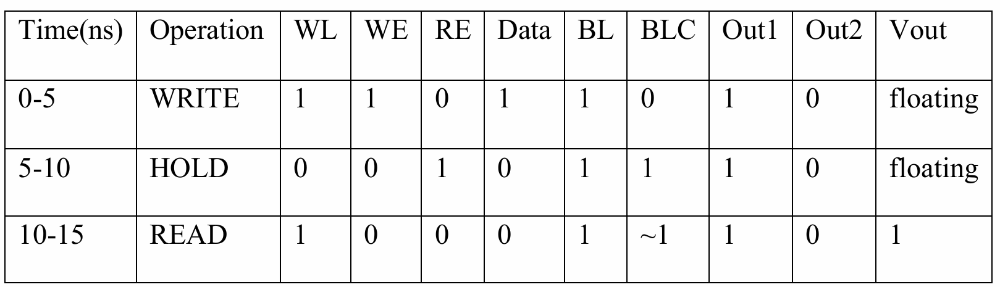

# 6T-SRAM-cell

An SRAM (Static Random Access Memory) cell is a bistable memory element used to store one bit 
of data. A conventional SRAM cell consists of six MOS transistors (6T): two cross-coupled CMOS 
inverters that form a latch for data storage, and two access transistors that connect the cell to the bit 
lines during read and write operations. Unlike DRAM, SRAM does not require periodic refreshing as 
long as power is supplied, making it faster and more reliable for high-speed applications such as 
processor caches and embedded memories. 

# Working

Case 1: Storing bit 1 in SRAM cell

